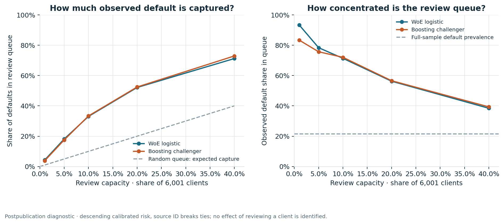

# Consumer credit risk and review strategy

[](https://github.com/Prasanna-K-123/consumer-credit-risk-strategy/actions/workflows/verify.yml)

**Credit-card model development, independent validation, review-capacity analysis
and US market-risk reporting in one reproducible software project.**

The client study compares an interpretable scorecard with a boosting challenger
on 30,000 historical Taiwanese card customers. A separate market pack reconstructs
56 quarters of official US large-bank card aggregates. These populations support
different questions and remain separate throughout the analysis.

[Decision memo](reports/DECISION_MEMO.md) ·
[Research report](reports/RESEARCH_REPORT.md) ·
[CART and policy sensitivity](reports/STRATEGY_REPORT.md) ·
[Independent SQL evidence](reference/card_clients/sql_review/review.json) ·
[Executed reproduction](reports/EXECUTION_RECEIPT.json) ·
[Reproduction guide](docs/REPRODUCE.md)

## Findings

At **10% review capacity**, the historical boosting queue contains **600 clients**
and captures **33.4% of observed defaults**; **72.0%** of that queue defaults.
This describes risk concentration and review workload in the Taiwan cohort,
rather than prevented defaults or monetary savings.

On the historical 6,001-client evaluation, the challenger has higher ROC AUC,
while the scorecard has higher average precision. The paired intervals do not
establish that the challenger improves probability accuracy or illustrative
decision cost. Separate calibration worsens both models' raw test Brier scores.

| Calibrated model | ROC AUC | Average precision | Brier score | Assumed error cost |
|---|---:|---:|---:|---:|
| WoE/logistic scorecard | 0.7814 | 0.5697 | 0.130794 | 3,322 |
| Histogram boosting | 0.7897 | 0.5658 | 0.130042 | 3,287 |

Cost is five units per missed default plus one per nondefault flagged for review;
it is not money, an approval policy or a measured intervention benefit. Thresholds
come from the separate policy-validation partition. The client evaluation is a
grouped snapshot holdout from an already published historical experiment.

The US pack shows why origination volume and exposure mix need separate views:
in 2026 Q2, borrowers with original credit scores below 660 account for **18.52%
of new accounts but 4.19% of new commitments** in the published large-bank series.
The report examines this alongside delinquency, payment and charge-off indicators.

A separate retrospective extension fits a fixed **depth-three CART tree with
eight readable segments** and evaluates all three models under **five assumed
missed-default/false-alarm cost ratios**. High assumed missed-default costs can
lead to reviewing almost everyone, exposing the need to ground costs and capacity
before choosing an operating policy. These added comparisons use known historical
outcomes and do not create a new untouched test.



## Software and controls

| Component | Implementation | Reviewable evidence |
|---|---|---|
| Client-risk research | Training-only WoE, logistic and boosting models; separate calibration and policy selection; paired group bootstrap | [Methodology](docs/CARD_METHODOLOGY.md), [replay verification](reference/card_clients/replay/verification.json) |
| Batch scoring | Strict 20-feature CSV contract, source-verified refits, probabilities, review flags and exact scorecard log-odds decomposition | `python -m consumer_cards score --help` |
| Capacity decisions | Seven fixed queue sizes, deterministic outcome-blind ties, capture/workload and assumed cost | [Queue results](reference/card_clients/replay/decision_queue.csv) |
| Interpretable strategy | Fixed shallow CART, training-only segment rules, separate calibration, five policy-cost assumptions and constant-policy benchmarks | [Strategy report](reports/STRATEGY_REPORT.md), [independent review](reference/card_strategy/independent_review.json) |
| Independent validation | SQLite population, ranking, calibration, segments and decisions; a separate Python metric implementation | [SQL controls](docs/SQL_CONTROLS.md), [queries](card_audit/sql/) |
| US market reporting | Pinned official CSV acquisition, strict schema/units, 50 metrics and 21 integrity/reconciliation checks | [Market methodology](docs/MARKET_METHODOLOGY.md), [market results](reference/us_market/report.json) |

The SQL review checks all 30,000 partition records, all 6,001 evaluation records
and all 84,014 model/capacity/customer queue assignments. Source, protocol and
artifact corruption fail explicitly, including under `python -O`.

## Run

Python 3.12. The source downloads are public; no account, API key or paid service
is needed. From a fresh checkout:

```bash
python -m venv .venv
source .venv/bin/activate
python -m pip install -r requirements.txt
python -m pytest -q
python tools/reproduce.py --output work/current
```

On Windows, activate `.venv\Scripts\Activate.ps1` in PowerShell. Reproduction
downloads or hash-checks official sources, refits the fixed historical models,
repeats calibration and bootstrap calculations, runs independent SQL controls,
reconstructs the market pack and generates the reports. It writes a receipt only
after the complete chain succeeds. Choose a new output folder for subsequent
runs; published references are preserved.

The [GitHub verification workflow](.github/workflows/verify.yml) performs the
same checks on a standard public Linux runner. It uploads no artifacts or caches.

## Scope and provenance

The card cohort describes existing customers in Taiwan in 2005; it cannot
establish US acquisition performance, temporal generalization, recoveries or
realized lending profit. Duplicate model-input groups never cross partitions.
Sex, education and marital status are excluded from fitting; age is retained
under the historical protocol. Segment diagnostics do not certify fairness or
legal compliance.

The original study's code, recorded protocol and results are preserved with
immutable hashes in [research history](docs/CARD_HISTORY.md). Its public import
does not independently establish a protocol committed before outcomes. Current
queue, SQL and reporting extensions are retrospective diagnostics, with no new
unseen-test claim.

The US aggregates describe reporting large banks, and published earlier periods
can be revised. They provide market context, rather than account-level validation
of the Taiwan models. No employer affiliation, regulatory approval or production
adoption is claimed. [Source attribution and rights](docs/DATA_RIGHTS.md).

The executed tree uses Python CART. SAS, CHAID and CECL/CCAR workflows are not
implemented. The [coverage and access notes](docs/COVERAGE_AND_ACCESS.md) explain
the outstanding data and runtime dependencies.
