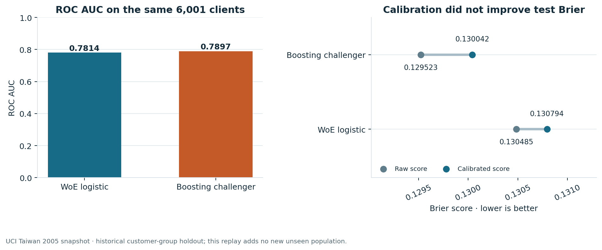
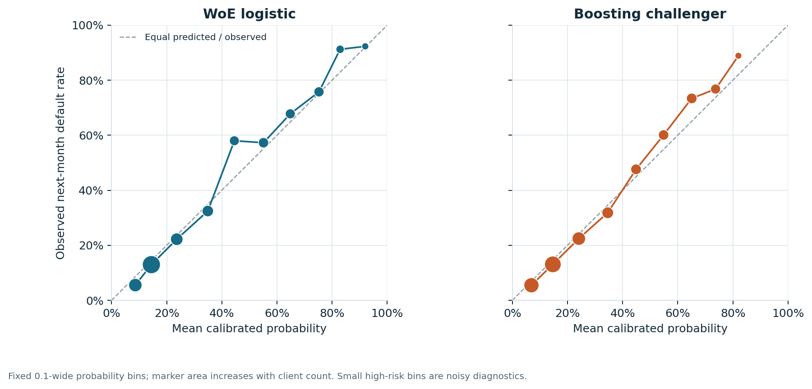
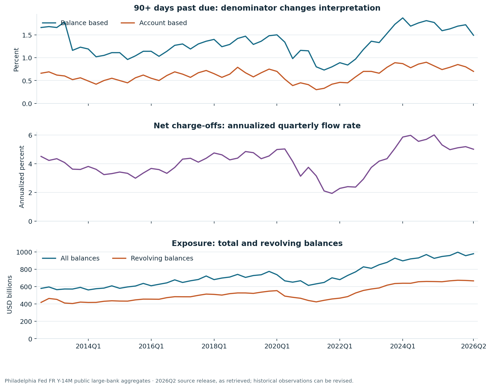
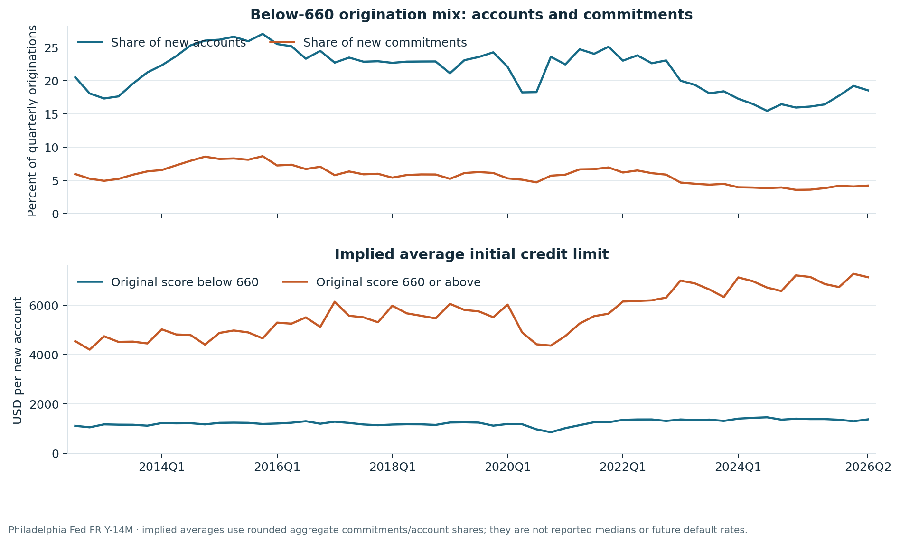

# Consumer credit risk: models, review queues and market evidence

This study asks how a risk reviewer can compare an interpretable scorecard with a flexible challenger, quantify the workload of a fixed review policy, and reconcile the result independently. A separate market pack describes US consumer-bankcard conditions using public Federal Reserve aggregates.

## Decision

The challenger has higher historical ROC AUC; the scorecard has slightly higher average precision. Probability-quality and assumed operating-cost gains remain uncertain. Keep both models as research benchmarks and investigate calibration and segment behavior before proposing a new policy. The US market pack supplies exposure and delinquency context; its aggregates are never joined to Taiwanese clients or used as evidence of US borrower-model performance.

## 1. Existing-card customer risk: historical Taiwan snapshot

UCI's 30,000 existing credit-card customers supply the same 20 model predictors for each model. Identical model-input vectors stay in one partition. ID, sex, education and marital status do not enter the models; sex remains available for diagnostic comparison. Age is a model predictor. The final historical evaluation contains **6,001 clients and 1,295 defaults (21.58%)**.

| Role | Clients | Feature groups | Defaults |
| --- | --- | --- | --- |
| Train | 18,007 | 17,861 | 3,964 |
| Calibration | 2,992 | 2,977 | 680 |
| Policy Validation | 3,000 | 2,977 | 697 |
| Test | 6,001 | 5,954 | 1,295 |

The scorecard learns five-quantile weight-of-evidence transforms on training data. The challenger is the historical fixed histogram-gradient-boosting model. Each uses the same training, calibration, policy-validation and test clients. Separate regularized logistic calibration and policy-validation choices remain frozen. A review threshold minimizes the stated scenario cost **5 × missed defaults + nondefault clients flagged** on policy-validation data.

| Model | ROC AUC | Average precision | Brier calibrated | Brier raw | Log loss | Frozen threshold | Assumed cost units |
| --- | --- | --- | --- | --- | --- | --- | --- |
| WoE logistic | 0.7814 | 0.5697 | 0.1308 | 0.1305 | 0.4217 | 0.15 | 3,322 |
| Boosting challenger | 0.7897 | 0.5658 | 0.1300 | 0.1295 | 0.4175 | 0.21 | 3,287 |

A constant score equal to training default prevalence (**22.01%**) has test Brier **0.16925**, calculated from the frozen train/test counts. Under the stated cost assumption, flagging nobody costs **6,475 units** and flagging everybody costs **4,706 units**. The model policies improve on these simple reference decisions in this historical sample; that comparison does not measure an intervention benefit.

Calibration increases test Brier for both historical models. This observation is retained as a finding; these known outcomes are not used to select a replacement calibration. The scorecard has slightly higher average precision despite the challenger's higher ROC AUC. Average precision should be read against the **21.58%** sample default prevalence.

| Challenger minus scorecard | Observed difference | 95% paired group-bootstrap interval |
| --- | --- | --- |
| ROC AUC | 0.008243 | [0.000555, 0.016102] |
| Brier | -0.000752 | [-0.002191, 0.000646] |
| Assumed cost / client | -0.005832 | [-0.032834, 0.019433] |

Intervals use **2,000 paired model-input-group resamples** with fitted models, calibration and thresholds fixed. They do not include fitting or model-selection uncertainty. The cost interval includes zero. ROC improvement alone does not establish a useful policy improvement.

## 2. Review capacity: what is actually measured

| Model | Capacity | Clients flagged | Defaults flagged | Default capture | Queue default rate |
| --- | --- | --- | --- | --- | --- |
| Boosting challenger | 5% | 300 | 227 | 17.5% | 75.7% |
| WoE logistic | 5% | 300 | 235 | 18.1% | 78.3% |
| Boosting challenger | 10% | 600 | 432 | 33.4% | 72.0% |
| WoE logistic | 10% | 600 | 428 | 33.1% | 71.3% |
| Boosting challenger | 20% | 1,200 | 679 | 52.4% | 56.6% |
| WoE logistic | 20% | 1,200 | 675 | 52.1% | 56.2% |

These postpublication queues sort calibrated probabilities descending and break ties by source ID. They quantify observed default concentration and nondefault review workload. They do not identify whether reviewing a client prevents default, reduces loss, or increases profit. Monetary loss severity, recoveries and treatment effects are not observed here. The original threshold-policy cost comparison is an assumed 5:1 error tradeoff, not a currency return.

## 3. Independent SQL and numerical challenge

SQLite statements reproduce population, threshold confusion accounting, calibration bins, segment summaries and capacity queues. Separate rank-grouping calculations verify ROC AUC and average precision; direct arithmetic verifies Brier and log loss. The audit rejects missing, extra or duplicate identities, inconsistent partition labels and invalid probabilities before calculation.

| Executed control | Violations |
| --- | --- |
| cross_partition_feature_groups | 0 |
| missing_test_keys | 0 |
| extra_or_wrong_partition_keys | 0 |
| prediction_group_disagreement | 0 |
| malformed_probabilities | 0 |
| missing_model_customer_pairs | 0 |

The review status is **PASS**. This is a second software implementation inside one project, not an outside validator's approval. Query files and CSV evidence are committed; the reproduction commands also generate a queryable SQLite database locally under `reference/card_clients/sql_review/`.

## 4. US large-bank card conditions: a separate population

The Philadelphia Fed market pack contains **56 quarterly observations per source table**, from **2012Q3 to 2026Q2**. Balances, commitments and accounts are stocks; originations and purchases are quarterly flows. Net charge-offs are annualized. Balance-based and account-based delinquency have different denominators.

| Metric | 2026Q2 value | Unit / meaning |
| --- | --- | --- |
| Total balances | 978.09 | USD billions · quarter-end stock |
| Revolving balances | 665.69 | USD billions · subset of balances |
| 90+ DPD, balances | 1.49 | Percent of balances |
| 90+ DPD, accounts | 0.70 | Percent of accounts |
| Net charge-off rate | 5.01 | Annualized percent · quarterly flow rate |

| Market indicator | Current (%) | Year earlier (%) | Change (percentage points) |
| --- | --- | --- | --- |
| 90+ delinquency by balance | 1.49 | 1.59 | -0.10 |
| Annualized net charge-off rate | 5.01 | 5.31 | -0.30 |
| Active accounts making minimum payment | 10.15 | 10.72 | -0.57 |
| New accounts with original score below 660 | 18.52 | 16.08 | +2.44 |
| New commitments with original score below 660 | 4.19 | 3.58 | +0.61 |

Below-660 borrowers account for **18.52%** of new accounts and **4.19%** of new commitments in the latest quarter. The implied average initial line is about **USD 1,372** for that group. These rounded-aggregate line-size diagnostics motivate investigation of mix and exposure; they do not measure subsequent defaults.

The pack preserves missing source values, validates headers, units, quarter keys and source footers, checks balance/account relationships, and generates year-over-year and quarter-over-quarter comparisons. A pinned release reproduces this retrieved version of revised history. It does not establish the exact information available at every historical publication date. Public aggregate reporting does not disclose the account microdata required for a US borrower-level credit model.

## 5. Provenance, reproduction and scope

The original card protocol, implementation and results are preserved under `reference/card_clients/historical/`. Their first recorded commit contains protocol and outcomes together; this is a historical recorded protocol, not independently certified preregistration. The current replay and added diagnostics are postpublication work on known outcomes. The UCI source is credited to I-Cheng Yeh under CC BY 4.0; Philadelphia Fed source terms are separate from the software license.

See `docs/CARD_METHODOLOGY.md`, `docs/CARD_HISTORY.md`, `docs/SQL_CONTROLS.md` and `docs/MARKET_METHODOLOGY.md` for definitions and full reproduction instructions. This presentation is generated from the executed replay, independent review and market pack. Input identities:

| Input | SHA256 |
| --- | --- |
| Card replay summary | `1e09b502b89f65464cd97d95965f2f519c11233ac0d86c5d9ac873f61924c7c7` |
| Calibration bins | `fc032fd24968a4ae268bbec332ec3fc963981b947c5963f949cfbaf07007b4e8` |
| Decision queues | `52dd78d8e6d06c6394813824f7e7357b81099318ab801a9c5497a8a6f85423a7` |
| Independent SQL review | `af532a998bd179912032d465b9c36206a1d64059e8dc871b6b836faf1e08aedf` |
| US quarterly pack | `a64f84e4f54317bc84d4b5740c65b2656cab335cf965df9d73388863cda5c472` |
| US market report | `d4c390a3e60e28248aca744876e25a0898ac1969a24c2b14aa40a445a029b5a4` |

The data support historical existing-card risk ranking and a reproducible market report. Deployment, acquisition underwriting, realized profitability, independent institutional approval, and CECL/CCAR compliance require evidence this study does not contain.
