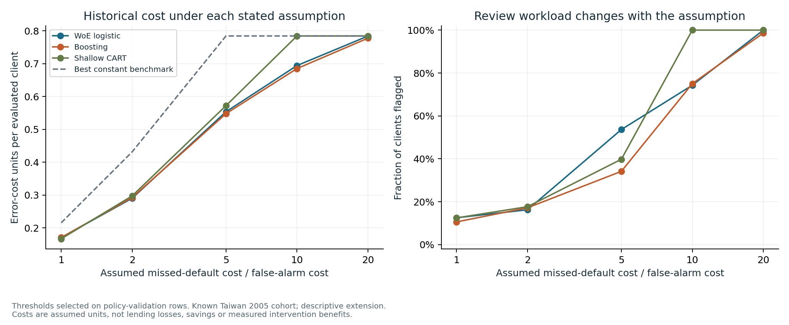

# Retrospective card strategy: interpretable segments and cost sensitivity

**Decision question.** How do readable customer segments and different assumed error costs change the workload of a review policy?

**Use.** Compare the complete scenario set and explain the tradeoff. Confirm actual operating costs, capacity and intervention effects before selecting a business policy. A shallow tree provides readable segments; its simplicity does not establish superior risk prediction.

This extension adds a fixed depth-three CART classifier in Python to the preserved scorecard and boosting research. The same 20 predictors and original four data roles are used: fitting on training rows, calibration on calibration rows, and threshold selection on policy-validation rows. Each ratio is selected independently on the declared 0.01–0.99 grid; the lowest threshold wins exact cost ties. Every declared result is reported.

The historical cohort and its evaluation outcomes were already known when this extension was designed. These are retrospective comparisons, with no new untouched-test, US borrower-performance, monetary-profit, SAS or CHAID claim.

## Predictive evidence

| Model | ROC AUC | Average precision | Raw Brier | Calibrated Brier |
| --- | ---: | ---: | ---: | ---: |
| WoE logistic | 0.7814 | 0.5697 | 0.130485 | 0.130794 |
| Boosting | 0.7897 | 0.5658 | 0.129523 | 0.130042 |
| Shallow CART | 0.7445 | 0.5016 | 0.132265 | 0.132684 |

All evaluation results concern the same 6,001 historical customers. Extension results are descriptive point estimates; the original paired bootstrap intervals are not uncertainty intervals for this new tree or these additional scenarios.

## Policy-cost scenarios

| Model | FN:FP cost | Threshold | Reviewed | Defaults captured | Cost units | Best constant cost |
| --- | ---: | ---: | ---: | ---: | ---: | ---: |
| WoE logistic | 1:1 | 0.44 | 752 (12.5%) | 39.5% | 1,025 | 1,295 |
| WoE logistic | 2:1 | 0.36 | 976 (16.3%) | 46.9% | 1,742 | 2,590 |
| WoE logistic | 5:1 | 0.15 | 3,219 (53.6%) | 82.0% | 3,322 | 4,706 |
| WoE logistic | 10:1 | 0.12 | 4,459 (74.3%) | 93.0% | 4,165 | 4,706 |
| WoE logistic | 20:1 | 0.05 | 5,999 (100.0%) | 100.0% | 4,704 | 4,706 |
| Boosting | 1:1 | 0.51 | 636 (10.6%) | 35.0% | 1,025 | 1,295 |
| Boosting | 2:1 | 0.37 | 1,032 (17.2%) | 48.0% | 1,756 | 2,590 |
| Boosting | 5:1 | 0.21 | 2,050 (34.2%) | 67.4% | 3,287 | 4,706 |
| Boosting | 10:1 | 0.10 | 4,503 (75.0%) | 93.7% | 4,110 | 4,706 |
| Boosting | 20:1 | 0.04 | 5,918 (98.6%) | 99.8% | 4,665 | 4,706 |
| Shallow CART | 1:1 | 0.39 | 749 (12.5%) | 40.2% | 1,002 | 1,295 |
| Shallow CART | 2:1 | 0.23 | 1,062 (17.7%) | 48.0% | 1,786 | 2,590 |
| Shallow CART | 5:1 | 0.13 | 2,388 (39.8%) | 69.9% | 3,433 | 4,706 |
| Shallow CART | 10:1 | 0.01 | 6,001 (100.0%) | 100.0% | 4,706 | 4,706 |
| Shallow CART | 20:1 | 0.01 | 6,001 (100.0%) | 100.0% | 4,706 | 4,706 |

Cost = assumed FN weight × missed defaults + 1 × nondefault clients flagged. Review-all and review-none are transparent comparison policies. Costs at different ratios use different assumptions and cannot be read as changing realized bank losses. Higher review coverage also consumes more operational capacity. Ranking a client does not establish that a review changes the outcome.

## Readable CART segments

The fixed tree has **8 leaves**, depth **3**, and at least **211 training rows per leaf**. Splits minimize training Gini impurity; calibration and evaluation outcomes do not select the tree structure. PAY status codes are split numerically and must be interpreted using the original codebook. Age remains a predictor; no fairness or regulatory certification follows.

| Leaf | Training clients | Training default rate | Evaluation clients | Evaluation default rate | Rule |
| --- | ---: | ---: | ---: | ---: | --- |
| 3 | 4,058 | 21.6% | 1,326 | 21.3% | `PAY_0 <= 1.5 AND PAY_2 <= 1.5 AND PAY_AMT3 <= 664.5` |
| 4 | 10,734 | 11.5% | 3,613 | 10.8% | `PAY_0 <= 1.5 AND PAY_2 <= 1.5 AND PAY_AMT3 > 664.5` |
| 6 | 931 | 38.5% | 313 | 32.3% | `PAY_0 <= 1.5 AND PAY_2 > 1.5 AND PAY_5 <= 1` |
| 7 | 414 | 51.0% | 139 | 56.8% | `PAY_0 <= 1.5 AND PAY_2 > 1.5 AND PAY_5 > 1` |
| 10 | 211 | 55.5% | 61 | 59.0% | `PAY_0 > 1.5 AND PAY_5 <= 1 AND BILL_AMT3 <= 9692` |
| 11 | 890 | 66.4% | 273 | 67.0% | `PAY_0 > 1.5 AND PAY_5 <= 1 AND BILL_AMT3 > 9692` |
| 13 | 243 | 79.8% | 88 | 84.1% | `PAY_0 > 1.5 AND PAY_5 > 1 AND BILL_AMT1 <= 19079.5` |
| 14 | 526 | 72.6% | 188 | 79.3% | `PAY_0 > 1.5 AND PAY_5 > 1 AND BILL_AMT1 > 19079.5` |

Leaf rates describe observed concentration in a single historical cohort. Compare role-specific support and errors before treating a segment as stable. Raw and calibrated probabilities, all four role counts and exact paths are supplied in `reference/card_strategy/leaf_segments.csv`; the complete tree is in `tree.txt`.

## Independent checks and reproduction

A separate SQLite/direct-arithmetic implementation rechecks scenario selection, evaluation accounting, capacity ordering, metrics and leaf support. The report refuses missing source reconciliation, a failed review or evidence changed since that review. The fixed original models' evaluation probabilities are also reconciled to the preserved historical predictions.

Run `python tools/reproduce.py --output work/current` for the complete chain. For a standalone extension, run `python -m card_strategy --source .cache/uci_card_clients.xls --output work/strategy`, then `python tools/audit_strategy.py --evidence work/strategy --source .cache/uci_card_clients.xls --output work/strategy/independent_review.json`.

Evidence: [protocol](../reference/card_strategy/protocol.json), [scenario table](../reference/card_strategy/policy_sensitivity.csv), [independent review](../reference/card_strategy/independent_review.json), [source/method limits](../docs/CARD_METHODOLOGY.md).
